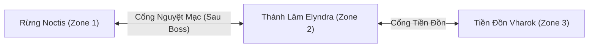

# NOCTELYRA — 2D Action RPG Cross-platform (Milestone M6: World Expansion & Zone Travel)

Dự án game Fantasy 2D màn hình ngang phát triển bằng **Godot 4.3 (GDScript)**, hướng tới phát hành PC (Steam), Android và iOS.

---

## 1. Cấu trúc thư mục & Module dự án (Bản M6 WORLD EXPANSION)

```text
D:\project\game\NOCTELYRA\
├── .gitignore                      # Loại bỏ cache Godot (.godot/)
├── README.md                       # Tài liệu hướng dẫn, kiến trúc thế giới mở & kết quả kiểm thử M6
├── CODE_EXPORT.txt                 # Toàn bộ mã nguồn dự án cho AI review (đã cập nhật M6 Final)
├── test_m6_flow.gd                 # [M6] Kịch bản kiểm thử 18 nhóm tính năng dịch chuyển thế giới (81/81 tests PASS 100%)
├── test_m5_flow.gd                 # Kịch bản kiểm thử 26 nhóm tính năng ma pháp (100/100 tests PASS 100%)
├── test_m4_flow.gd                 # Kịch bản kiểm thử 17 hạng mục Boss M4 (87/87 tests PASS 100%)
├── test_m3_2_flow.gd               # Kịch bản kiểm thử M3.2 (50/50 tests PASS 100%)
├── test_m3_1_flow.gd               # Kịch bản kiểm thử M3.1 (41/41 tests PASS 100%)
├── test_m3_flow.gd                 # Kịch bản kiểm thử M3 (67/67 tests PASS 100%)
├── test_m2_1_flow.gd               # Kịch bản kiểm thử M2.1 (42/42 tests PASS 100%)
├── icon.svg                        # Icon chuẩn của dự án (128x128 SVG)
├── project.godot                   # Main Scene: main_menu.tscn (1280x720, forward_plus, autoload ZoneManager M6)
├── run_game.bat                    # 1-Click chạy game test ngay lập tức
├── open_editor.bat                 # 1-Click mở Godot Editor
├── export_code_for_ai.bat          # 1-Click gom toàn bộ source code thành file CODE_EXPORT.txt
│
├── source_assets\                  # TÀI NGUYÊN NGUỒN (Được cách ly bằng .gdignore, không đưa vào build)
│   ├── .gdignore                   # Khai báo Godot Engine bỏ qua thư mục này khi import/export
│   ├── README.md                   # Hướng dẫn tái tạo Atlas từ ảnh Strip
│   ├── repack_sprites.ps1          # Script PowerShell tự động cắt và đóng gói lại Atlas vuông
│   ├── player_idle_strip.png       # Dải ảnh gốc 48 frame Idle (24.576 x 680 px)
│   └── player_run_strip.png        # Dải ảnh gốc 14 frame Run (7.168 x 680 px)
│
├── assets\
│   └── sprites\
│       └── player\
│           ├── player_idle_atlas.png         # Đã tối ưu Atlas 2048x2040 (8 cols x 6 rows, 48 frames)
│           ├── player_idle_atlas.png.import
│           ├── player_run_atlas.png          # Đã tối ưu Atlas 1024x1360 (4 cols x 4 rows, 14 frames)
│           └── player_run_atlas.png.import
│
└── src\
    ├── actors\
    │   ├── player\
    │   │   ├── player.gd                    # FSM Player, dọn sạch đạn khi chết/hồi sinh, combat, di chuyển
    │   │   ├── player.tscn                  # Scene Player có SpellbookComponent & InventoryComponent
    │   │   └── player_movement_data.gd      # Resource thông số di chuyển, nhảy đôi, dash
    │   ├── npc\
    │   │   ├── npc.gd                       # Logic NPC đa năng: Elyra (Noctis), Kaelis (Elyndra), Rhaek (Vharok)
    │   │   └── npc.tscn                     # Scene NPC (collision_layer = 0: xuyên người mượt mà)
    │   └── enemy\
    │       ├── enemy.gd                     # Enemy AI, làm chậm 35%, rơi Tinh thể Ma lực an toàn
    │       └── enemy.tscn                   # Scene Enemy với thanh máu HPBar mini, hitbox & hurtbox
    ├── boss\                                # MODULE BOSS LUNARETH — LINH LỘC NGUYỆT THỰC
    │   ├── boss_lunareth.gd                 # Miễn nhiễm slow, bất tử 1.3s Phase Transition, shockwave
    │   ├── boss_lunareth.tscn               # Scene Boss với HealthComponent (320 HP), Hurtbox, Hitbox
    │   ├── boss_visual.gd                   # Visual chuyển phase, aura tím, telegraph
    │   ├── boss_shockwave.gd                # Projectile group 'boss_projectiles'
    │   └── boss_shockwave.tscn              # Scene projectile sóng xung kích
    ├── combat\
    │   ├── damage_info.gd                   # Struct dữ liệu sát thương & knockback
    │   ├── health_component.gd              # Quản lý máu, MP, hồi MP tự nhiên, bất tử
    │   ├── hurtbox.gd                       # Vùng nhận đòn chuyển tiếp tới HealthComponent
    │   ├── hitbox.gd                        # Vùng gây sát thương chém cận chiến
    │   ├── combat_component.gd              # Điều phối chém kiếm và ủy quyền cast_spell sang SpellbookComponent
    │   ├── magic_projectile.gd              # Projectile cũ (giữ tương thích)
    │   └── magic_projectile.tscn
    ├── magic\                               # HỆ THỐNG PHÁP THUẬT CHIẾN ĐẤU
    │   ├── spell_definition.gd              # Custom Resource: tỉ lệ tăng cấp unrounded (100%, 115%, 130%), giá nâng cấp
    │   ├── spell_database.gd                # Thông số thiết kế chuẩn M5.1 (15 MP/0.6s, 25 MP/2.0s, 18 MP/1.0s)
    │   ├── spellbook_component.gd           # Quản lý danh sách phép, phép đang chọn, cấp độ, cooldown độc lập
    │   └── projectiles\
    │       ├── moon_bolt_projectile.gd      # Đạn ánh trăng 550 px/s, đơn mục tiêu (30.0 / 34.5 / 39.0 DMG)
    │       ├── moon_bolt_projectile.tscn
    │       ├── ember_bloom_projectile.gd    # Đạn lửa 380 px/s, nổ AoE 110 px (22.0 / 25.3 / 28.6 DMG)
    │       ├── ember_bloom_projectile.tscn
    │       ├── frost_shard_projectile.gd    # Đạn băng 650 px/s, làm chậm quái 35% trong 2s (20.0 / 23.0 / 26.0 DMG)
    │       └── frost_shard_projectile.tscn
    ├── interaction\
    │   ├── interaction_coordinator.gd       # Bộ điều phối Input tập trung cho NPC, Cổng dịch chuyển & Cổ Tinh Thạch
    │   └── interaction_component.gd         # Area2D tương tác nhận diện Player phạm vi gần
    ├── inventory\                           # HỆ THỐNG VẬT PHẨM & TRANG BỊ
    │   ├── item_definition.gd               # Resource định nghĩa vật phẩm chuẩn
    │   ├── item_database.gd                 # Đăng ký mana_shard, health_potion, moonsteel_sword, moon_amulet, eclipse_fragment
    │   ├── inventory_component.gd           # Quản lý 16 ô túi đồ, clear(), remove_item_by_id()
    │   ├── equipment_component.gd           # Quản lý 2 ô trang bị & tính toán lại chỉ số
    │   ├── inventory_ui.gd                  # Controller giao diện túi đồ, lưới 16 ô
    │   └── inventory_ui.tscn                # Scene giao diện túi đồ
    ├── loot\                                # HỆ THỐNG RƠI ĐỒ VÀ NHẶT VẬT PHẨM
    │   ├── loot_table.gd                    # Resource định nghĩa bảng tỷ lệ rơi đồ
    │   ├── item_pickup.gd                   # Gán pickup_id ổn định, tự hủy nếu đã nhặt trước đó
    │   └── item_pickup.tscn                 # Scene vật phẩm rơi với hiệu ứng nhấp nhô lơ lửng
    ├── quest\
    │   ├── quest_data.gd                    # Resource dữ liệu nhiệm vụ (4 trạng thái FSM)
    │   └── quest_manager.gd                 # Quản lý quest, lưu enemy_id chuỗi ổn định xuyên suốt
    ├── save\                                # HỆ THỐNG LƯU / TẢI TIẾN TRÌNH OFFLINE
    │   └── save_manager.gd                  # Version 1.3.0, lưu current_zone_id & zone_states, tương thích 1.0.0 -> 1.2.0
    ├── ui\
    │   ├── spell_hotbar.gd                  # Controller thanh chọn phép 3 ô [1], [2], [3] & nút [U]
    │   ├── spell_hotbar.tscn                # Scene thanh hotbar hiển thị highlight, cooldown, MP, Lv
    │   ├── game_ui.gd                       # Tích hợp hotbar, thông báo Zone Banner & nhãn ZoneLabel
    │   ├── game_ui.tscn                     # CanvasLayer HUD, Bars, Dialogue, PauseMenu, Hotbar, Zone HUD
    │   ├── pause_controller.gd              # Quản lý Pause/Resume độc lập
    │   ├── main_menu.gd                     # Màn hình chính (Continue nạp trực tiếp scene khu vực đã lưu)
    │   └── main_menu.tscn
    └── world\                               # [M6] HỆ THỐNG MỞ RỘNG THẾ GIỚI & DỊCH CHUYỂN KHU VỰC
        ├── zone_definition.gd               # Resource metadata khu vực (zone_id, name, subtitle, scene_path, default_spawn)
        ├── zone_spawn_point.gd              # Điểm xuất hiện an toàn trong khu vực (spawn_point_id, facing_direction)
        ├── zone_portal.gd                   # Cổng dịch chuyển liên khu vực, điều kiện mở khóa, hiệu ứng xoáy ma pháp
        ├── zone_portal.tscn                 # Scene Area2D Cổng dịch chuyển với prompt nhấp nháy
        ├── ancient_crystal.gd               # Cổ Tinh Thạch tương tác đọc truyền thuyết (Lore object)
        ├── ancient_crystal.tscn             # Scene Cổ Tinh Thạch với visual tinh thể phát sáng
        ├── base_zone.gd                     # Lớp cha BaseZone quản lý vòng đời khu vực, camera, retry và đăng ký ZoneManager
        ├── zone_manager.gd                  # Autoload Singleton điều phối dịch chuyển, bảo toàn chỉ số & lưu trạng thái vùng
        ├── magic_gate.gd                    # Cổng Ma Pháp tại X=4200 (khóa arena Boss Lunareth)
        ├── magic_gate.tscn                  # Scene Cổng Ma Pháp rào chắn vật lý
        ├── noctis_forest.gd                 # [Zone 1] Rừng Noctis (0-6000px), Moonveil Portal sau Boss Arena
        ├── noctis_forest.tscn
        ├── elyndra_glade.gd                 # [Zone 2] Thánh Lâm Elyndra (0-2400px), NPC Kaelis, Cổ Tinh Thạch, 2 Cổng
        ├── elyndra_glade.tscn
        ├── vharok_outpost.gd                # [Zone 3] Tiền Đồn Vharok (0-2400px), NPC Rhaek (Quỷ tộc bán thú), 1 Cổng
        └── vharok_outpost.tscn
```

---

## 2. Thiết kế 3 Vùng Đất Thế Giới Mở Rộng (M6 World Design)

### 2.1. Rừng Noctis (`noctis_forest`)
- **Tên hiển thị:** Rừng Noctis — Nơi Khởi Đầu Của Bóng Tối
- **Kích thước:** Chiều dài 6000 px, camera giới hạn $0 \rightarrow 6000$ px.
- **Thực thể & Sự kiện:**
  - NPC Elyra (X=400): Giao nhiệm vụ tiêu diệt 3 Thú Tha Hóa.
  - Cổng Ma Pháp MagicGate (X=4200): Tự động mở khi hoàn thành nhiệm vụ.
  - Boss Arena & Đấu trường Lunareth (X=4400 - 5800): Trận chiến Boss Linh Lộc Nguyệt Thực.
  - **Cổng Nguyệt Mạc (Moonveil Portal - X=5850):** Nằm phía sau đấu trường Boss. Khóa ma thuật vững chắc cho đến khi thanh tẩy Lunareth (`boss_defeated == true`). Khi tương tác thành công sẽ dịch chuyển tới Thánh Lâm Elyndra.
  - **Điểm xuất hiện trở về (`SpawnFromElyndra`):** Tọa độ X=5700, quay mặt hướng trái (-1) hướng vào phía trung tâm rừng.

### 2.2. Thánh Lâm Elyndra (`elyndra_glade`)
- **Tên hiển thị:** Thánh Lâm Elyndra — Tinh Mạch Của Tinh Linh
- **Kích thước:** Chiều dài 2400 px, camera giới hạn $0 \rightarrow 2400$ px.
- **Phong cách thị giác:** Tông màu xanh ngọc bích (emerald), bạc (silver) và tím nhạt huyền ảo. Cây cổ thụ phát sáng và các platform lơ lửng.
- **Thực thể & Sự kiện:**
  - **NPC Kaelis — Người Canh Giữ Tinh Mạch (X=1150):** Tinh linh dẫn chuyện giải thích về dòng chảy ma lực và sự tha hóa.
  - **Cổ Tinh Thạch — Ancient Crystal (X=1350):** Tảng pha lê cổ xưa chứa đựng mảnh vỡ ký ức về thảm họa nguyệt thực.
  - **Cổng dịch chuyển về Noctis (`PortalToNoctis` - X=140):** Dịch chuyển về `noctis_forest` tại `spawn_from_elyndra`.
  - **Cổng dịch chuyển sang Vharok (`PortalToVharok` - X=2260):** Dịch chuyển tới `vharok_outpost` tại `spawn_from_elyndra`.
  - **Điểm xuất hiện an toàn:** `SpawnFromNoctis` (X=280, facing +1) và `SpawnFromVharok` (X=2120, facing -1).

### 2.3. Tiền Đồn Vharok (`vharok_outpost`)
- **Tên hiển thị:** Tiền Đồn Vharok — Ranh Giới Quỷ Tộc Bán Thú
- **Kích thước:** Chiều dài 2400 px, camera giới hạn $0 \rightarrow 2400$ px.
- **Phong cách thị giác:** Tông màu đá sẫm, tím thẫm và đỏ thẫm kiên cố. Kiến trúc công sự phòng thủ với các ngọn đuốc rực cháy.
- **Thực thể & Sự kiện:**
  - **NPC Rhaek — Vệ Binh Gia Tộc (X=1200):** Đại diện cho nền văn minh Quỷ tộc bán thú (văn minh, kỷ luật, tự trọng, không mặc định là phản diện).
  - **Cổng dịch chuyển về Elyndra (`PortalToElyndra` - X=140):** Dịch chuyển về `elyndra_glade` tại `spawn_from_vharok`.
  - **Điểm xuất hiện an toàn:** `SpawnFromElyndra` (X=280, facing +1).

---

## 3. Kiến Trúc Dịch Chuyển & Bảo Toàn Trạng Thái



### 3.1. Bảo toàn Thông số Player (Player State Extraction & Injection)
Khi dịch chuyển qua `ZoneManager.travel_to_zone()`, toàn bộ dữ liệu người chơi được trích xuất và áp dụng nguyên vẹn sang instance Player mới:
- **Máu & Ma lực:** Giữ nguyên giá trị thực tế không bị hồi đầy ngoài ý muốn (MP tiếp tục hồi phục thụ động tự nhiên theo `mana_regen_rate`).
- **Túi đồ (16 ô) & Trang bị:** Nguyên vẹn mọi vật phẩm, vũ khí và phụ kiện.
- **Ma pháp & Spellbook:** Phép đang chọn, cấp độ nâng cấp phép, thời gian hồi chiêu độc lập.
- **Vàng & Tiến độ Nhiệm vụ:** Bảo toàn số dư ví vàng và trạng thái nhiệm vụ hiện hành.

### 3.2. Lưu trữ Trạng thái Thế giới Riêng Từng Vùng (`zone_states`)
Mỗi khu vực được theo dõi trạng thái độc lập:
- `collected_pickup_ids`: Danh sách ID vật phẩm đã nhặt — **không bao giờ hồi sinh lại**.
- `defeated_enemy_ids`: Danh sách quái vật đã hạ gục — giữ nguyên trạng thái bị tiêu diệt.
- `dropped_pickups`: Vật phẩm quái rơi chưa kịp nhặt được bảo toàn chính xác.
- `boss_defeated` & `boss_reward_claimed`: Trạng thái thanh tẩy Boss Lunareth được duy trì vĩnh viễn, không xảy ra lỗi nhận thưởng đúp hay sinh thêm Boss thứ hai.

### 3.3. Cơ Chế Chống Ping-Pong & An Toàn Vị Trí
- **Hồi chiêu dịch chuyển (Anti-pingpong Cooldown):** Đặt thời gian hồi $1.5$ giây ngay sau khi đặt chân tới khu vực mới, ngăn chặn việc kích hoạt ngược trở lại ngay lập tức.
- **Khoảng cách an toàn (Safe Distance Offset):** Điểm spawn luôn cách cổng dịch chuyển $\ge 100$ px (thực tế 140 px), nằm ngoài bán kính tương tác của Area2D (35 px).

---

## 4. Nâng Cấp Hệ Thống Lưu / Tải Dữ Liệu v1.3.0

- **Phiên bản bản lưu:** `1.3.0`.
- **Khối dữ liệu mở rộng:**
  - `current_zone_id`: Ghi nhận khu vực hiện tại người chơi đang đứng (`noctis_forest`, `elyndra_glade`, `vharok_outpost`).
  - `zone_states`: Lưu trữ toàn bộ dữ liệu nhặt đồ, tiêu diệt quái, phần thưởng Boss của từng vùng đất.
- **Tương thích ngược 100%:** Nạp hoàn hảo các bản lưu cũ `1.0.0` (M3.2), `1.1.0` (M4), và `1.2.0` (M5.1). Tự động gán `current_zone_id = "noctis_forest"` đối với các bản lưu cũ chưa có trường này.
- **Cơ chế Continue từ Main Menu:** Khi bấm "Tiếp tục" tại Main Menu, `SaveManager.get_save_zone_scene_path()` sẽ tải trực tiếp scene khu vực mà người chơi đã lưu trước đó, đưa người chơi xuất hiện chính xác tại đúng vùng đất đó.
- **An toàn giao dịch File:** Sử dụng cơ chế ghi file tạm `.tmp` $\rightarrow$ kiểm tra JSON $\rightarrow$ backup `.bak` $\rightarrow$ đổi tên an toàn. Từ chối lưu khi đang diễn ra trận đánh Boss hoặc trong lúc đang chuyển cảnh khu vực.

---

## 5. Báo cáo Kiểm thử Tự động Tổng hợp trên Godot 4.3 Engine

Tất cả các bộ test đều chạy trong môi trường Engine thực tế (`Godot_v4.3-stable_win64_console.exe --headless`):

```text
========================================================================================
 BỘ KIỂM THỬ                         | SỐ TEST    | KẾT QUẢ      | MÃ THOÁT (EXIT CODE)
----------------------------------------------------------------------------------------
 test_m6_flow.gd (Thế giới & Portal) |  81 tests  | PASS 100%    | 0
 test_m5_flow.gd (Ma pháp M5.1)      | 100 tests  | PASS 100%    | 0
 test_m4_flow.gd (Boss Lunareth M4)  |  87 tests  | PASS 100%    | 0
 test_m3_2_flow.gd (Save/Load M3.2)  |  50 tests  | PASS 100%    | 0
 test_m2_1_flow.gd (NPC & Quest M2)  |  42 tests  | PASS 100%    | 0
========================================================================================
 TỔNG CỘNG                           | 360 tests  | PASS 100%    | HOÀN HẢO KHÔNG LỖI
========================================================================================
```

---

## 6. Hướng dẫn Điều khiển & Trải nghiệm

| Phím bấm | Hành động |
| :--- | :--- |
| **A / D** | Di chuyển trái / phải |
| **Space** | Nhảy đơn / Nhảy đôi (Double Jump) |
| **Shift** | Lướt nhanh (Dash) |
| **J** | Tấn công cận chiến (Chém kiếm) |
| **K** | Thi triển phép thuật đang chọn (Bắn ma pháp, tiêu hao MP) |
| **1, 2, 3** | Chọn phép thuật: [1] Nguyệt Quang Đạn \| [2] Tinh Hỏa Bùng Nổ \| [3] Hàn Tinh Tiễn |
| **U** | Nâng cấp phép thuật đang chọn (Tiêu hao Tinh thể Ma lực `mana_shard`) |
| **E** | Tương tác NPC (Elyra, Kaelis, Rhaek) / Kích hoạt Cổng dịch chuyển / Đọc Cổ Tinh Thạch |
| **I** | Mở / Đóng túi đồ (Inventory) & Bảng trang bị |
| **Esc** | Tạm dừng trò chơi (Pause Menu) / Đóng túi đồ / Đóng hội thoại |
